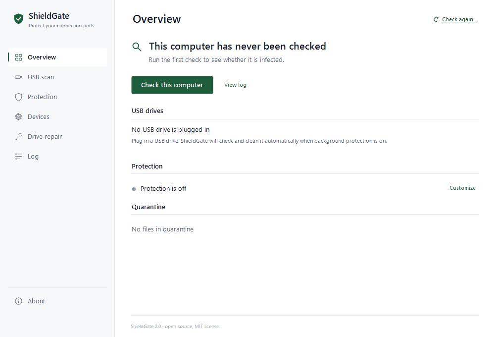
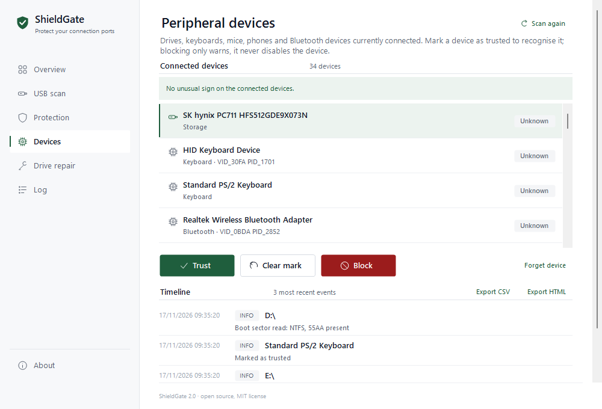

<p align="center">
  
</p>

<h1 align="center">ShieldGate</h1>

<p align="center">
  <b>Malware guard for USB drives and peripherals on Windows.</b><br>
  Scans removable drives, removes shortcut-virus traces, repairs the damage those viruses leave behind.
</p>

<p align="center">
  <a href="https://github.com/GnasValluk/shieldgate-usb-guard/actions/workflows/build.yml"></a>
  <a href="https://github.com/GnasValluk/shieldgate-usb-guard/releases/latest"></a>
  
  
  
  
</p>

<p align="center">
  
</p>

One portable `.exe`. No installer, no drivers, no network access, no telemetry.
Vietnamese and English interface.

## Why

- **USB shortcut viruses** spread through `autorun.inf`, `.lnk` files, hidden
  folders and signed decoy payloads. ShieldGate reads the shortcut structure, the
  folder markers, the file names and the hashes, so renamed payloads still match.
- **Findings come first.** Nothing is deleted until you see the list, and every
  quarantine can be undone.
- **Repair, not just detection.** ShieldGate can clean the drive and fix the
  Run keys, scheduled tasks and `.lnk` files a drive virus left on the PC.

## A look inside

| Devices | Drive repair |
|---|---|
|  |  |
| Inventory with VID/PID/serial, trust marks, event timeline | Diagnose, preview, back up, check the file system; icons name themselves on hover |

## What is new in 2.0

- **Rules live in `rules.json`.** File names, extensions and score weights can be
  updated without rebuilding. A missing or corrupt file falls back to the
  built-in defaults.
- **New detectors.** Double extensions (`report.pdf.exe`), right-to-left
  override characters in names, scripts at the drive root, `.url`/`.scf` files
  leaking NTLM hashes, alternate data streams, root `desktop.ini` with a CLSID,
  sideloaded DLLs and Office macro files.
- **Peripheral inventory.** Storage, HID, Bluetooth, MTP and composite devices
  with VID/PID/serial. Trust is stored by a stable device key, never by drive
  letter.
- **Event timeline.** Device, scan, behaviour, protection and repair events in
  one local timeline, exportable to CSV or HTML.
- **Drive repair page.** Diagnose, read-test, preview and create a backup, run
  `chkdsk`, read the boot sector. Every write refuses the system drive.
- **Optional write protection and execution blocking.** Both off by default,
  both need confirmation, both can be undone.

## What it detects

On removable drives:

- Shortcuts, scripts and `autorun.inf` pointing at hidden folders, drive roots
  or odd payloads.
- Nameless or hidden folders used to stash data, and hidden executables at
  drive roots.
- Fake folder executables, `Documents`/`Docusment` lookalike folders with a
  system CLSID in `desktop.ini`, and known payload bundles (`1.exe`,
  `opera_elf.dll`, `adback.dat`, `link.dat`, `icudtl.dat`). `1.exe` is a validly
  signed Opera binary used as a decoy, so a good signature alone does not clear
  it.
- Double extensions, RLO spoofed names, root scripts, NTLM leaks, alternate data
  streams, sideload-prone DLL names and Office macro files. Macros are
  **flagged only** and never auto-quarantined.

On the PC: Run/RunOnce, `Winlogon`, `AppInit_DLLs`, `MountPoints2`, the Startup
folder, scheduled tasks, WMI event subscriptions, modified `.lnk` files,
unsigned executables in user folders, system process names running from the
wrong path, and Explorer registry keys.

## Pages

| Page | Shortcut | Purpose |
|---|---|---|
| Overview | `Ctrl+1` | State, last check, quarantine restore and cleanup |
| USB scan | `Ctrl+2` | Scan a removable drive, choose items, quarantine, unhide |
| Protection | `Ctrl+3` | AutoRun/script/registry policy, write protection, execution blocking |
| Devices | `Ctrl+4` | Peripheral inventory, trust marks, event timeline, export |
| Drive repair | `Ctrl+5` | Diagnose, read-test, back up, `chkdsk`, boot-sector report, Defender |
| Log | `Ctrl+6` | Activity log |
| About | `Ctrl+7` | Version, data folder, uninstall |

## What it does

- Quarantine runs only on the items you keep selected, and can be undone. Data
  inside a nameless folder moves to the drive root; nothing is overwritten, and
  duplicates get `(1)`.
- Fix removes malicious Run/Winlogon/MountPoints/`.lnk` values, disables tasks,
  deletes WMI consumers and bindings and stops related processes. Registry
  repair runs `reg export` first. Every action is logged.
- **Unhide files** moves data out of nameless folders and clears the hidden
  attribute across a drive.

## Protection

Optional, off by default, needs administrator rights.

- Disable AutoRun and block `autorun.inf`.
- Block Windows Script Host. Turn this on only if you do not need VBScript.
- Registry protection: keep checking Explorer keys, repair only damaged ones.
- Background watch: scans a removable drive when it is plugged in, rechecks
  drive roots, inventories devices, watches for write bursts and warns about
  new, blocked, composite or suspected BadUSB devices.
- **USB write protection** (opt-in) sets the Windows storage policy so removable
  volumes mount read-only.
- **Execution block** (opt-in) periodically stops processes whose executable is
  on a removable drive. This is a point-in-time stop, not a kernel guarantee.

Registry fixes stay after protection is turned off; restoring broken values
would break Explorer again. Device **Block** only marks and warns — ShieldGate
never disables a device, use Windows Device Manager for that.

## Drive repair

Deliberately conservative:

- **Diagnose** reads file system, capacity, read-only state, dirty bit and the
  system-drive flag. Reading does not write.
- **Preview backup** runs `robocopy /L` and reports file count and size without
  copying. If robocopy prints a localized summary, the count falls back to a
  local tree walk.
- **Back up** copies the drive into the data folder's `repair` directory and
  writes a `backup-<letter>.ok` marker. It refuses the system drive, a
  destination outside `repair`, or a destination on the source drive.
- `chkdsk` read-only asks once. `chkdsk /f` requires administrator rights, a
  completed backup marker and two confirmations.
- **Boot-sector report** reads the first 512 bytes and reports the file system
  and the `55AA` signature. It never writes.
- Windows Defender is called only when you press the button.

## Run

Download `ShieldGate.exe` from Releases and run it. First start asks for a data
folder and a language (Vietnamese or English); the choice is stored in
`%LOCALAPPDATA%\ShieldGate\setup.ini`. Delete that file to run setup again.

1. Open **USB scan**, choose a drive, click **Scan USB**.
2. Clear the items you want to keep, then click **Quarantine**.
3. If data is still hidden, use **Unhide files**.
4. Restore quarantined files from **Overview**.
5. Check **Devices** to see what is connected and mark familiar hardware.
6. Use **Drive repair** only when a drive misbehaves; preview the backup first.

The GUI and protection request administrator rights through UAC. `--scan`,
`--status`, `--devices`, `--events`, `--repair` and `--selftest` do not.

## Command line

```
ShieldGate.exe                            GUI
ShieldGate.exe --status                   protection state
ShieldGate.exe --scan E:\                 read-only scan
ShieldGate.exe --devices                  list peripheral devices
ShieldGate.exe --events [n]               last n timeline events
ShieldGate.exe --repair E:\               diagnose a drive (read-only)
ShieldGate.exe --defender <path>          manual Windows Defender scan
ShieldGate.exe --install                  install background protection
ShieldGate.exe --install --blockscript    also block Windows Script Host
ShieldGate.exe --uninstall                remove protection, restore Windows
ShieldGate.exe --watch                    background worker, used by the task
ShieldGate.exe --tray                     tray icon worker
ShieldGate.exe --selftest                 self-test in a temp folder
```

- `--scan` exits `0` when clean, `2` when it finds items and `1` on error. It
  stops after 150,000 files or 300 seconds and reports that the drive was only
  partly checked.
- `--repair` only diagnoses and prints results. It never backs up, runs
  `chkdsk` or writes to a drive; those actions live in the GUI with explicit
  confirmation.
- `--defender` exits `0` when clean, `2` when Defender reports a threat and `1`
  on error.
- Flags work with `--` or `-`.

## Data

Default folder: `C:\ProgramData\ShieldGate`, falling back to
`%LOCALAPPDATA%\ShieldGate`.

```
settings.txt        settings, scan counters, tray notice state
guard.cfg           protection choices
rules.json          detection rules and weights (created from defaults)
devices.json        device trust store, keyed by instance/VID/PID/serial
events.tsv          event timeline, rotated at 2 MB
last_scan.txt       last machine scan result
log\shieldgate.log  activity log, rotated at 5 MB
quarantine\         quarantined files and manifests
backup\             Windows config and registry backups
repair\             drive backups and backup markers
bin\ShieldGate.exe  background copy plus SHA256
```

While protection is on, the data folder is limited to Administrators and SYSTEM.
Standard users get read access only where needed, not to `quarantine`, `backup`
or `repair`. `events.tsv` stores device names, paths and action results, never
file contents. Nothing leaves the machine.

## Build

Needs Windows and the .NET Framework 4.0 compiler (`csc.exe`); Visual Studio is
not required.

```powershell
powershell -ExecutionPolicy Bypass -File build.ps1   # dist\ShieldGate.exe
powershell -ExecutionPolicy Bypass -File test.ps1    # self-test, 35/35
```

The source is C# 5 and WinForms. `src\core` holds the logic, `src\ui` the
interface. Every user-facing string is in `src\ui\Strings.cs` in both languages,
and the log follows the selected language.

```
src\core\      paths, JSON, rules, detectors, devices, events, policy,
               behaviour, Defender, repair, scanning, quarantine, protection
src\ui\        forms, pages, dialogs, setup, strings, self-test
tests\         self-test entry point
assets\        icon
tools\         icon generator
legacy\4.8\    old single-file PowerShell version
```

The self-test writes only inside its temp folder and covers detection,
quarantine, restore, hidden folders, JSON, rules, scoring, the detector
pipeline, device trust, the event timeline, repair guards and the backup marker.

## Limits

- Tuned on one real sample (`GnasValluk`/`Docusment`), not measured on a wide
  corpus. Release targets are under 0.5% false positives and under 5% misses;
  more samples will be added.
- Not an antivirus. It does not scan the whole system drive and does not replace
  Defender.
- No checks for services, drivers, IFEO/COM hijacks or Defender exclusions.
  Registry coverage is limited to Explorer keys and the policies that block
  repairs.
- USB write protection is the Windows global removable-storage policy, not a
  per-device setting. Execution blocking is a periodic process stop, not an
  absolute kernel block.
- BadUSB detection is a heuristic: a new keyboard plus a recent shell process.
  It is not a guarantee and does not attribute individual keystrokes.
- Drive repair deliberately does **not** write boot sectors or MBRs, format
  drives, carve deleted files, or run TestDisk/PhotoRec. Those need a
  clean-sample comparison and stronger safeguards first.
- `chkdsk /f` writes to the drive and may change data. The backup is a file
  copy, not a sector image; it cannot restore boot-sector damage.
- VirusTotal and YARA are not included. Both need extra network or native
  components and a clear opt-in design.
- The GUI and the SYSTEM watcher exchange files in the data folder with ACLs.
  There is no authenticated named pipe, so do not run the GUI as a standard
  user with a shared data folder.
- A scan can stop early at 150,000 files or 300 seconds.
- No network, optical or MTP *scanning*; MTP devices are inventory only.
- The release is unsigned. SmartScreen may warn; compare the SHA256 before
  running.

## License

MIT. See [LICENSE](LICENSE). Report bugs in Issues and include the Windows
version, the device type and the last lines of `shieldgate.log`.
