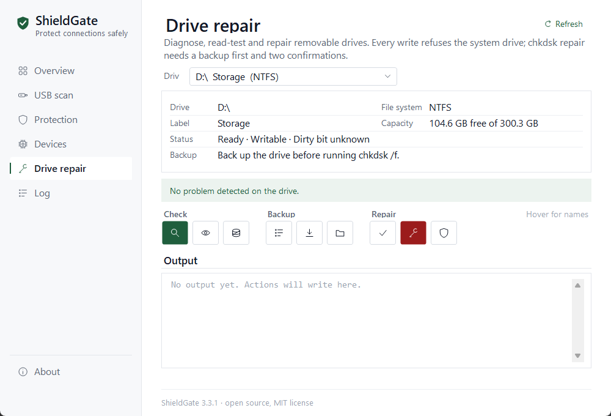

<p align="center">
  
</p>

<h1 align="center">ShieldGate</h1>

<p align="center">
  <b>Malware guard for USB drives and peripherals on Windows.</b><br>
  Scans removable drives, removes shortcut-virus traces, repairs the damage those viruses leave behind.
</p>

<p align="center">
  <a href="https://github.com/GnasValluk/shieldgate-usb-guard/actions/workflows/build.yml"></a>
  <a href="https://github.com/GnasValluk/shieldgate-usb-guard/releases/latest"></a>
  
  
  
  
</p>

<p align="center">
  
</p>

One portable `.exe`. No installer, no drivers, no telemetry, and no network access
unless you turn on the optional VirusTotal lookup and run `--vt` yourself.
Vietnamese and English interface. See [PRIVACY.md](PRIVACY.md).

## Why

- **USB shortcut viruses** spread through `autorun.inf`, `.lnk` files, hidden
  folders and signed decoy payloads. ShieldGate reads the shortcut structure, the
  folder markers, the file names and the hashes, so renamed payloads still match.
- **Findings come first.** Nothing is deleted until you see the list, and every
  quarantine can be undone.
- **Repair, not just detection.** ShieldGate can clean the drive and fix the
  Run keys, scheduled tasks and `.lnk` files a drive virus left on the PC.

## A look inside

| Devices | Drive repair |
|---|---|
|  |  |
| Inventory with VID/PID/serial, trust marks, event timeline | Diagnose, preview, back up, check the file system; icons name themselves on hover |

## What is new in 3.0

- **A standard-user GUI can still clean a whole drive.** When background
  protection runs as SYSTEM, the local pipe lets the unelevated GUI run the
  whole-drive clean and unhide on removable media. Folder work and every other
  page keep the file + ACL path.
- **Only the installed GUI may connect.** The pipe accepts one local client at a
  time and checks PID, image path, session, user SID and a SHA-256 pin written by
  `--install`; clients from another machine or an anonymous account are closed.
- **Off by default.** `--pipe` shows the state, `--pipe on`/`off` (administrator)
  changes it and asks for a restart of background protection. Every write uses a
  two-step plan/apply with `confirm:true` and expires after 120 seconds.
- **Nothing else changes.** Version 3.0 keeps the 2.3 scan, repair and BadUSB
  behaviour; the pipe is an opt-in extra path.
- **3.0.1** closes the folder picker with a single click on X; before, the shell
  dialog could reopen once after it was closed.

## What is new in 2.1–2.3

- **A folder can be scanned without touching the whole drive.** `Scan a folder…`
  on the USB page picks any folder outside the system drive, then the same
  detection, quarantine, unhide and rename actions run on it. Drive-only actions
  such as `autorun.inf` vaccination stay hidden in folder mode. `--scan` accepts
  a folder path too.
- **Original document names can be restored.** The worm renamed documents to
  Base64 inside fake folders. `Restore original names` decodes only names that
  become a valid document name (no path or control characters, a document
  extension, never a payload extension), runs only inside fake or nameless
  folders, never overwrites and logs every rename.
- **Fake folders show the data they still hold.** A scan reports how many user
  files were kept because only executable payloads are quarantined, instead of
  making the folder look empty.
- **The Protect switch turns off again.** Turning every protection switch off
  now writes an all-off `guard.cfg` and remembers the previous choices in
  `guard.last`, so the switch no longer springs back on after a restart.

- **Signatures are verified, not just detected.** Executables and DLLs go through
  `WinVerifyTrust`; Windows catalog signatures are checked for system files, and
  the check uses only local caches (no network). A fake, revoked or broken
  signature no longer counts as signed.
- **64-bit processes are visible to the 32-bit build.** Blocking execution from
  removable drives now reads each process path with
  `QueryFullProcessImageName`, so a 64-bit program started from a USB drive is no
  longer skipped silently.
- **External keyboards are recognised.** A USB, Bluetooth or composite HID
  keyboard is no longer mistaken for the built-in laptop keyboard, so the
  new-keyboard and composite-device warnings can actually fire. Internal ACPI,
  ROOT, SWD and I2C HID keyboards stay excluded. This remains a heuristic.
- **Detection names and the score gate come from `rules.json`.** Executable
  names, system-process names, payload names/hashes/sizes, script markers and
  command patterns are no longer hard-coded. A strong signal whose score stays
  below `scoreThreshold` is now only a warning and is never auto-quarantined by
  the background guard.
- **Long paths are scanned.** Directory walking uses the `\\?\` API, so a USB
  tree deeper than 260 characters is no longer skipped at the first long folder.
- **Scans skip work that cannot help.** A file without a PE certificate table
  never enters `WinVerifyTrust`, and signature results are cached by path, size
  and last-write time. Alternate data streams are only probed on NTFS, and
  Office macro detection reads the last 1 MB (the ZIP central directory)
  instead of the first 8 MB. Flag-only findings are hidden behind an
  "N flagged items" chip so they do not bury the real threats.
- **Write protection steps aside for cleaning.** When ShieldGate itself enabled
  write protection, quarantine, restore, unhide and vaccinate lift it for the
  duration of the operation, then put it back. A `wp-pending` note with a
  10-minute expiry re-locks the drive at startup or from the background loop if
  the app was killed mid-clean. A lock set by Windows or the user is never
  lifted automatically.
- **Burst alerts look at what is written.** Copying 300 `.txt` files to a drive
  no longer starts a full scan. A burst now needs 15+ `.lnk`/script/payload
  files, or 400 items that include at least one of them. The same drive alerts
  at most once every 10 minutes instead of every two minutes.
- **`chkdsk /f` answers the dismount prompt.** Standard input is redirected with
  `Y`, so a drive with open handles no longer waits until the six-hour timeout.
  If another prompt appears, stdin is already closed and `chkdsk` takes its
  default instead of blocking. The self-test never runs `chkdsk`.
- **VirusTotal is opt-in and the key is never stored in plaintext.** The Protect
  page has an off-by-default switch, a one-time consent dialog and an API key
  field. The key is encrypted with DPAPI for the current Windows account, never
  written to `settings.txt` or the log, and deleted on uninstall. When a lookup
  is requested, only the file's SHA-256 hash is sent.
- **Scriptable CLI and a real privacy note.** `--scan <drive> --json` prints
  drive, counts, warnings and findings as JSON (paths and reasons only, never
  contents) and keeps the `0/1/2` exit codes. `--vt <file>` looks up one file's
  hash when VirusTotal is on. `--help` lists every command and exit code;
  `--version` prints the version. [PRIVACY.md](PRIVACY.md) documents every file
  ShieldGate writes and the single optional network request.
- **Re-infection loop is treated as a PC problem.** If one drive is cleaned three
  times in ten minutes, ShieldGate logs a warning, shows a tray balloon, and starts
  a read-only source hunt on the PC in the background. The log then names the
  process, task, service or file instead of only "N suspicious items".
- **Fix order changed: stop the source first.** `Check this PC` now stops processes
  and services, then removes tasks/WMI, then startup entries, and only then
  quarantines files. A file is no longer removed while the process holding it is
  still running.
- **Hidden and `\Microsoft\...` scheduled tasks are scanned.** Task Scheduler hides
  both by default. The XML is read directly, `[hidden]` is shown in the result, and
  a task under `\Microsoft\` is reported only when its command targets a
  user-writable folder, a script host or an odd numeric executable.
- **Services and drivers are checked.** A service whose `ImagePath` points to
  `ProgramData`, `AppData`, `Temp`, `Users\Public` or an unsigned binary outside
  Windows/Program Files is reported. The registry key is backed up, then the
  service is stopped and deleted, and its image is quarantined afterwards.
  Windows Defender's own platform folder is explicitly excluded.
- **Escalation after a fix.** If the drive is re-infected within 60 minutes after
  `Check this PC` was fixed, the warning changes to "the source may be a
  driver/rootkit — run Microsoft Defender Offline" instead of asking you to clean
  the same items again.

## Named pipe (off by default)

- **A local pipe with a pinned client.** `\\.\pipe\ShieldGate.Engine.v1` speaks
  versioned JSON frames (4-byte length, 64 KiB limit, one client at a time). The
  pipe ACL allows SYSTEM, Administrators and interactive users, and denies
  Network and Anonymous; a client from another machine is also rejected by name.
- **Only the installed GUI is accepted.** `--install` writes `bin\client.pin`
  with the installed exe path and its SHA-256. The server resolves the client
  PID, image path, session and user SID, then compares path and hash. A client
  that fails is closed with one WARN line.
- **Read commands and a scan job.** `status.get`, `devices.list`, `events.since`,
  `job.start`/`status`/`cancel` are wired. `clean`, `unhide` and `rename` have
  two-step `plan`/`apply` commands: the drive is one letter, the engine re-checks
  system drive, removable media, write access and volume serial, plans expire
  after 120 seconds and are bound to SID, session and drive, and every write
  needs `confirm:true`.
- **Off by default, switched with `--pipe`.** The pipe starts inside `--watch`
  only when `pipe.enabled=1` is set in `settings.txt`. `--pipe status` shows the
  setting, whether the engine is running and whether `bin\client.pin` exists;
  `--pipe on` and `--pipe off` (administrator) change it and ask for a restart of
  background protection. When it is on, a standard-user GUI uses it only for
  whole-drive clean/unhide; folder scans and all other pages keep the local file
  + ACL path. A failed pipe shows a message and never elevates the GUI by itself.
  Undo of a pipe clean needs administrator rights because the standard user
  cannot read the quarantine manifest.

## What is new in 2.0

- **Rules live in `rules.json`.** File names, extensions and score weights can be
  updated without rebuilding. The file is read only from the data folder; a
  `rules.json` beside the executable is ignored with a warning. Your entries are
  merged into the built-in defaults, so an older or partial file cannot remove
  extensions the program relies on. A missing or corrupt file falls back to the
  built-in defaults.
- **New detectors.** Double extensions (`report.pdf.exe`), right-to-left
  override characters in names, scripts at the drive root, `.url`/`.scf` files
  leaking NTLM hashes, alternate data streams, root `desktop.ini` with a CLSID,
  sideloaded DLLs and Office macro files.
- **Peripheral inventory.** Storage, HID, Bluetooth, MTP and composite devices
  with VID/PID/serial. Trust is stored by a stable device key, never by drive
  letter.
- **Event timeline.** Device, scan, behaviour, protection and repair events in
  one local timeline, exportable to CSV or HTML. CSV cells that start with
  `=`, `+`, `-` or `@` are prefixed with `'` so a spreadsheet does not run them.
  Every row has a monotonic ID; the tray reads from its last ID, so several
  notifications in the same five seconds are queued instead of overwritten, and
  rotating the file does not lose the cursor.
- **Drive repair page.** Diagnose, read-test, preview and create a backup, run
  `chkdsk`, read the boot sector. Every write refuses the system drive.
- **Optional write protection and execution blocking.** Both off by default,
  both need confirmation, both can be undone.

## What it detects

On removable drives:

- Shortcuts, scripts and `autorun.inf` pointing at hidden folders, drive roots
  or odd payloads.
- Nameless or hidden folders used to stash data, and hidden executables at
  drive roots.
- Fake folder executables, `Documents`/`Docusment` lookalike folders with a
  system CLSID in `desktop.ini`, and known payload bundles (`1.exe`,
  `opera_elf.dll`, `adback.dat`, `link.dat`, `icudtl.dat`). `1.exe` is a validly
  signed Opera binary used as a decoy, so a good signature alone does not clear
  it.
- Double extensions, RLO spoofed names, root scripts, NTLM leaks, alternate data
  streams, sideload-prone DLL names and Office macro files. Macros are
  **flagged only** and never auto-quarantined.

On the PC: Run/RunOnce, `Winlogon`, `AppInit_DLLs`, `MountPoints2`, the Startup
folder, scheduled tasks, WMI event subscriptions, modified `.lnk` files,
unsigned executables in user folders, system process names running from the
wrong path, and Explorer registry keys.

## Pages

| Page | Shortcut | Purpose |
|---|---|---|
| Overview | `Ctrl+1` | State, last check, quarantine restore and cleanup |
| USB scan | `Ctrl+2` | Scan a removable drive or a chosen folder, choose items, quarantine, unhide, restore Base64 names |
| Protection | `Ctrl+3` | AutoRun/script/registry policy, write protection, execution blocking |
| Devices | `Ctrl+4` | Peripheral inventory, trust marks, event timeline, export |
| Drive repair | `Ctrl+5` | Diagnose, read-test, back up, `chkdsk`, boot-sector report, Defender |
| Log | `Ctrl+6` | Activity log |
| About | `Ctrl+7` | Version, data folder, uninstall |

## What it does

- Quarantine runs only on the items you keep selected, and can be undone. Data
  inside a nameless folder moves to the drive root; nothing is overwritten, and
  duplicates get `(1)`.
- Inside a fake folder only executable payloads (`.exe`, `.dll`, `.dat`, `.lnk`,
  scripts, `desktop.ini`) are quarantined. Documents the worm renamed to Base64
  (`.doc`, `.docx`, `.pdf`, …) stay where they are, and such a folder is not
  deleted. One ShieldGate process cleans a drive at a time, so the GUI and the
  background watch never fight over the same files.
- Fix removes malicious Run/Winlogon/MountPoints/`.lnk` values, disables tasks,
  deletes WMI consumers and bindings and stops related processes. Registry
  repair runs `reg export` first and refuses to change a key if that backup
  failed (exit code checked, file must exist). Every action is logged.
- **Unhide files** moves data out of nameless folders. The automatic pass only
  clears items marked Hidden **and** System (the worm's `attrib +h +s`), so a
  real `desktop.ini`, `$RECYCLE.BIN` and folders you hid yourself keep their
  attributes; the button also clears Hidden-only items after you confirm.
- **BadUSB warning** (tray, on by default, no admin): counts key events per
  device (never key codes) and polls shell processes. It warns only when a new
  untrusted keyboard types very fast and opens a shell from Explorer. Warning
  only; it never disables a device.

## Protection

Optional, off by default, needs administrator rights.

- Disable AutoRun and block `autorun.inf`.
- Block Windows Script Host. Turn this on only if you do not need VBScript.
- Registry protection: keep checking Explorer keys, repair only damaged ones.
- Background watch: scans a removable drive when it is plugged in, rechecks
  drive roots, inventories devices, watches for write bursts and warns about
  new, blocked, composite or suspected BadUSB devices.
- **USB write protection** (opt-in) sets the Windows storage policy so removable
  volumes mount read-only. ShieldGate lifts its own lock only while it is
  cleaning a drive, then restores it.
- **Execution block** (opt-in) periodically stops processes whose executable is
  on a removable drive. This is a point-in-time stop, not a kernel guarantee.

Registry fixes stay after protection is turned off; restoring broken values
would break Explorer again. Device **Block** only marks and warns — ShieldGate
never disables a device, use Windows Device Manager for that.

## Drive repair

Deliberately conservative:

- **Diagnose** reads file system, capacity, read-only state, dirty bit and the
  system-drive flag. Reading does not write.
- **Preview backup** runs `robocopy /L` and reports file count and size without
  copying. If robocopy prints a localized summary, the count falls back to a
  local tree walk.
- **Back up** copies the drive into the data folder's `repair` directory and
  writes a `backup-<letter>.ok` marker. It refuses the system drive, a
  destination outside `repair`, or a destination on the source drive.
- `chkdsk` read-only asks once. `chkdsk /f` requires administrator rights, a
  completed backup marker and two confirmations.
- **Boot-sector report** reads the first 512 bytes and reports the file system
  and the `55AA` signature. It never writes.
- Windows Defender is called only when you press the button.

## Run

Download `ShieldGate.exe` from Releases and run it. First start asks for a data
folder and a language (Vietnamese or English); the choice is stored in
`%LOCALAPPDATA%\ShieldGate\setup.ini`. Delete that file to run setup again.

1. Open **USB scan**, choose a drive, click **Scan USB**. To check one folder
   instead, click **Scan a folder…**.
2. Clear the items you want to keep, then click **Quarantine**.
3. If data is still hidden, use **Unhide files**. If documents inside a fake
   folder have Base64 names, use **Restore original names**.
4. Restore quarantined files from **Overview**.
5. Check **Devices** to see what is connected and mark familiar hardware.
6. Use **Drive repair** only when a drive misbehaves; preview the backup first.

The GUI and protection request administrator rights through UAC. `--scan`,
`--status`, `--pipe status`, `--devices`, `--events`, `--repair`, `--vt`,
`--help`, `--version` and `--selftest` do not.

## Command line

```
ShieldGate.exe                            GUI
ShieldGate.exe --status                   protection state
ShieldGate.exe --pipe [on|off|status]     named pipe for a standard-user GUI
ShieldGate.exe --scan E:\                 read-only scan of a drive
ShieldGate.exe --scan "D:\folder"         read-only scan of one folder
ShieldGate.exe --scan E:\ --json          same scan as JSON for scripts
ShieldGate.exe --devices                  list peripheral devices
ShieldGate.exe --events [n]               last n timeline events
ShieldGate.exe --repair E:\               diagnose a drive (read-only)
ShieldGate.exe --defender <path>          manual Windows Defender scan
ShieldGate.exe --vt <file>                SHA-256 lookup on VirusTotal (must be on)
ShieldGate.exe --import-rules <file> --yes  replace rules.json after a validated import
ShieldGate.exe --install                  install background protection
ShieldGate.exe --install --blockscript    also block Windows Script Host
ShieldGate.exe --uninstall                remove protection, restore Windows
ShieldGate.exe --uninstall --purge-data   also delete quarantine and drive backups
ShieldGate.exe --watch                    background worker, used by the task
ShieldGate.exe --tray                     tray icon worker
ShieldGate.exe --selftest                 self-test in a temp folder
ShieldGate.exe --version                  print the version
ShieldGate.exe --help                     list commands and exit codes
```

- `--uninstall` keeps `quarantine` and `repair` (quarantined samples and drive
  backups) inside the data folder by default; `--purge-data` deletes them too.
  The GUI asks with a switch that is on by default. The VirusTotal key is always
  deleted.

- `--scan` accepts a drive or a folder. It exits `0` when clean, `2` when it
  finds items and `1` on error. It stops after 150,000 files or 300 seconds and
  reports that the target was only partly checked. With `--json`, stdout is one
  JSON object: `drive`, `files`, `items`, `seconds`, `truncated`, `readOnly`,
  `counts`, `warnings` and `findings[]` (each with `path`, `relative`, `kind`,
  `score`, `high`, `flagOnly`, `size`, `codes`, `reason`). Strings are escaped,
  and no file contents are included.
- `--repair` only diagnoses and prints results. It never backs up, runs
  `chkdsk` or writes to a drive; those actions live in the GUI with explicit
  confirmation.
- `--pipe` defaults to `status`. It reports the setting, whether background
  protection is running and whether the client pin exists. `--pipe on` and
  `--pipe off` need administrator rights and ask you to restart background
  protection; enabling it without `bin\client.pin` (written by `--install`)
  prints a warning. The pipe stays off unless you turn it on.
- `--defender` exits `0` when clean, `2` when Defender reports a threat and `1`
  on error.
- `--vt` exits `0` when no engine flags the file, `2` when at least one engine
  reports it as malicious or suspicious, and `1` when VirusTotal is off, the key
  is missing, the file cannot be read or the request fails. It sends only the
  SHA-256 hash; see [PRIVACY.md](PRIVACY.md).
- `--import-rules` parses the file first, keeps the previous one as
  `rules.json.bak`, then replaces the rules file in the data folder. It refuses
  to run without `--yes`, and exits `1` on a missing, oversized (>1 MB) or
  unreadable file.
- Flags work with `--` or `-`.

## Data

Default folder: `C:\ProgramData\ShieldGate`, falling back to
`%LOCALAPPDATA%\ShieldGate`.

```
settings.txt        settings and scan counters
guard.cfg           protection choices
guard.last          last non-empty protection choices, used when all switches are off
rules.json          detection rules and weights (created from defaults)
rules.json.bak      previous rules file, kept by --import-rules
devices.json        device trust store, keyed by instance/VID/PID/serial
events.tsv          event timeline, rotated at 2 MB
events.tsv.id       event counter; keeps the tray cursor across rotation
vt.key              VirusTotal API key, DPAPI-encrypted for this Windows account
last_scan.txt       last machine scan result
log\shieldgate.log  activity log, rotated at 5 MB
clean.lock          one cleaner per data folder at a time (GUI vs background)
quarantine\         quarantined files and manifests
backup\             Windows config and registry backups
repair\             drive backups and backup markers
bin\ShieldGate.exe  background copy plus SHA256
```

While protection is on, the data folder is limited to Administrators and SYSTEM.
Standard users get read access only where needed, not to `quarantine`, `backup`
or `repair`. `events.tsv` stores device names, paths and action results, never
file contents. Nothing leaves the machine unless you turn on VirusTotal and run
`--vt`; that request carries only the SHA-256 hash. See [PRIVACY.md](PRIVACY.md).

## Build

Needs Windows and the .NET Framework 4.0 compiler (`csc.exe`); Visual Studio is
not required.

```powershell
powershell -ExecutionPolicy Bypass -File build.ps1   # dist\ShieldGate.exe
powershell -ExecutionPolicy Bypass -File test.ps1    # self-test, 72/72
```

The source is C# 5 and WinForms. `src\core` holds the logic, `src\ui` the
interface. Every user-facing string is in `src\ui\Strings.cs` in both languages,
and the log follows the selected language.

```
src\core\      paths, JSON, rules, detectors, devices, events, policy,
               behaviour, Defender, repair, scanning, quarantine, protection
src\ui\        forms, pages, dialogs, setup, strings, self-test
tests\         self-test entry point
assets\        icon
tools\         icon generator
legacy\4.8\    old single-file PowerShell version
```

The self-test writes only inside its temp folder and covers detection,
quarantine, restore, hidden folders, long paths, JSON, rules, scoring, the score
gate, the detector pipeline, signature verification, the signature cache, the
macro tail read, ADS gating, device trust, the event timeline, repair guards,
the backup marker, VirusTotal, the CLI JSON/help output, the typing-rate
counter and the BadUSB decision matrix.

## Limits

- Tuned on one real sample (`GnasValluk`/`Docusment`), not measured on a wide
  corpus. Release targets are under 0.5% false positives and under 5% misses;
  more samples will be added.
- Not an antivirus. It does not scan the whole system drive and does not replace
  Defender.
- No checks for IFEO/COM hijacks or Defender exclusions. Service and driver
  checks are path/name heuristics, not a full integrity check. Registry coverage
  is limited to Explorer keys and the policies that block repairs.
- USB write protection is the Windows global removable-storage policy, not a
  per-device setting. Execution blocking is a periodic process stop, not an
  absolute kernel block.
- BadUSB detection is a heuristic: a new untrusted keyboard that types at a
  non-human rate and then opens a shell from Explorer. It is not a guarantee and
  does not attribute individual keystrokes. The tray counts events and timing
  only (never key codes) and polls process names/parents once per second (never
  command lines). It warns at most once per device per 10 minutes and never
  disables or blocks a device. It has not yet been measured against real BadUSB
  hardware; the test plan is in [docs/design-badusb.md](docs/design-badusb.md).
- Drive repair deliberately does **not** write boot sectors or MBRs, format
  drives, carve deleted files, or run TestDisk/PhotoRec. Those need a
  clean-sample comparison and stronger safeguards first.
- `chkdsk /f` writes to the drive and may change data. The backup is a file
  copy, not a sector image; it cannot restore boot-sector damage.
- VirusTotal is opt-in and manual. `--vt <file>` is the only command that sends
  anything, and it sends only the SHA-256 hash. Nothing is looked up in the
  background, and YARA is not included.
- The GUI and the SYSTEM watcher exchange files in the data folder with ACLs.
  An authenticated named pipe exists behind `pipe.enabled=1` (off by default).
  When enabled, only whole-drive clean/unhide from a standard-user GUI use it;
  policy changes still need administrator rights, and a portable GUI that is not
  the pinned `bin\ShieldGate.exe` is rejected.
- A scan can stop early at 150,000 files or 300 seconds.
- No network, optical or MTP *scanning*; MTP devices are inventory only.
- The release is unsigned. SmartScreen may warn; compare the SHA256 before
  running.

## License

MIT. See [LICENSE](LICENSE). Report bugs in Issues and include the Windows
version, the device type and the last lines of `shieldgate.log`.
